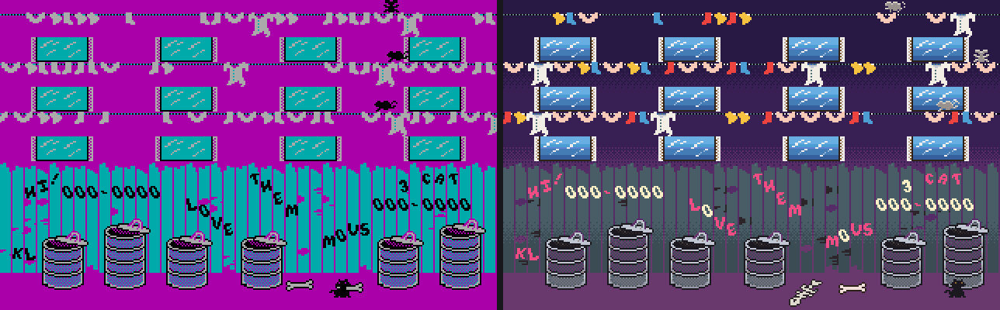
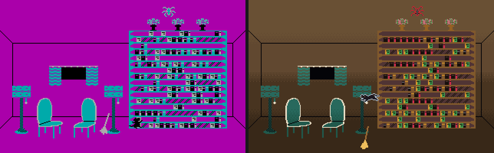
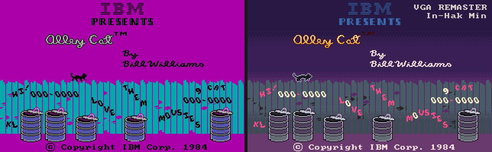
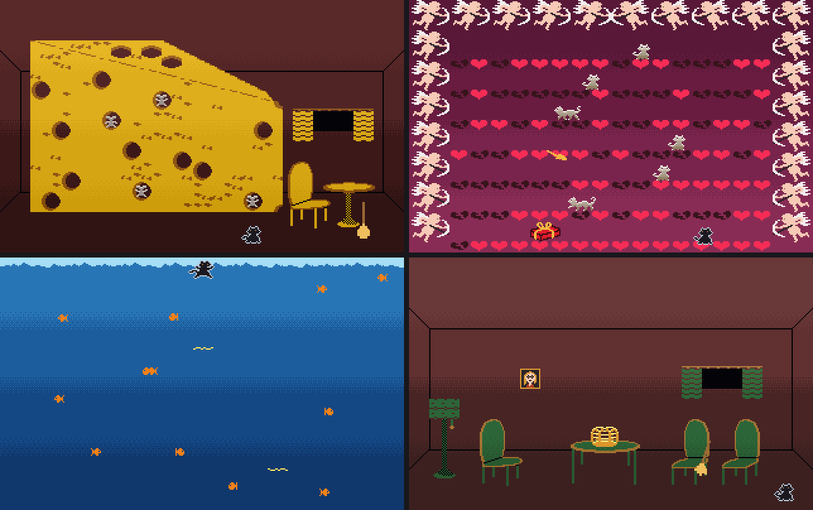
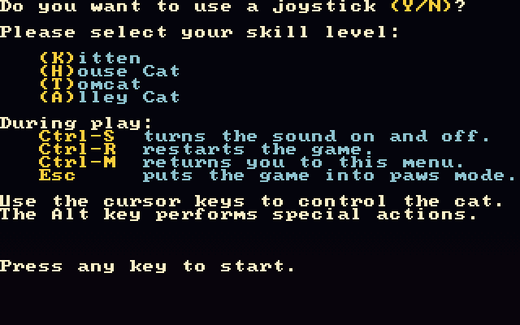

# 골목 고양이 (Alley Cat) — C 이식과 256색 개선판

1984년 IBM PC 용 **ALLEY CAT**(Bill Williams, SynSoft)을 역어셈블해 C 로 옮기고,
VGA 256색·애드립 음악·부드러운 움직임을 더한 개선판까지 함께 만든 것입니다.

* **ALLEY.EXE** — 원판 그대로. 게임 규칙, 속도, PC 스피커 소리가 1984년 판과 같습니다.
  원판이 CGA 320x200 4색으로 그리던 화면을 VGA 에 그대로 보여 줍니다.
* **ALLEYVGA.EXE** — 개선판. 그림마다 색을 새로 칠한 256색 화면, 애드립(OPL2) 배경음악,
  1점 단위로 이어지는 부드러운 움직임. **게임 규칙과 속도는 원판과 같습니다.**

| 왼쪽 원판(CGA 4색) / 오른쪽 개선판(VGA 256색) |
|---|
|  |
|  |
|  |

개선판의 방들 — 치즈의 쥐구멍, 사랑의 방, 어항 속, 새장



## 개선판에서 바뀐 것

**화면**
* 그림마다 새로 칠한 256색 (ALLEY256.SPR). 고양이, 불독, 쥐, 새, 물고기, 창문, 빨래,
  쓰레기통, 책장, 치즈, 어항, 하트, 타이틀 글자까지 전부 따로 칠했습니다.
* 방마다 다른 색 테마. 화면을 네 띠로 나눠 위아래로 색이 부드럽게 바뀌고,
  띠 경계는 16줄에 걸쳐 4x4 순서 디더로 섞습니다.
* 첫 화면, 빨랫줄 위, 방 안의 고양이는 배경과 구별되게 한 점 테두리를 그립니다.

**움직임** (게임 규칙은 그대로, 보여 주는 쪽만)
* 원판은 4점(CGA 한 바이트) 단위로 뚝뚝 옮기지만, 이 판은 1점 단위로 이어서 움직입니다.
* 동작 그림 사이에 중간 모양을 만들어 끼웁니다. 고양이는 두 모양의 거리장을 섞고,
  불독과 쥐는 손으로 그린 사이 그림(`tools/tweens.py`)을 씁니다.
* 원판이 같은 거리를 들쭉날쭉한 간격으로 옮기는 것(불독은 50ms, 117ms 번갈아)을
  최근 걸음의 평균 빠르기로 고르게 폅니다.
* 빨랫줄이 흐를 때도 줄 띠를 1점씩 이어서 밉니다.

**조작**
* 키를 누르면 바로 반응합니다. 원판은 다음 시계 틱과 화면 귀선을 기다려 최대 0.2초쯤 늦었습니다.
* 화살표 두 개로 대각선 뛰기가 됩니다. 두 키가 몇 ms 어긋나 눌려도 받아 줍니다.
* 어항 속 헤엄은 한 틱에 세 걸음(2.5배쯤 빠르고 방향 전환이 쉽습니다).
* `Ctrl-Q`, `Ctrl-X` 로 언제든 종료, `Alt+1`..`7` 로 각 방에 바로 들어갑니다.

**소리**
* 애드립(OPL2) 배경음악 (SOUND.DAT). 타이틀, 골목, 방, 어항, 사랑의 방, 판 끝 곡.
* 효과음은 원판대로 PC 스피커.

**속도** — 느린 실기에서도 제 속도로 돌아가게 만들었습니다.
* 그릴 때 마지막 256색 번호를 바로 적어 두어, 화면 합치기는 복사만 합니다.
* 줄마다 바뀐 구간만 다시 칠하고 그만큼만 화면 메모리로 옮깁니다.
* 게임이 8088 시간보다 뒤처지면 그리기를 미룹니다 (게임 속도가 먼저).

DOSBox 사이클을 고정해 잰 값입니다 (1초 동안 고양이가 걷는 거리 / 한 장 그리는 시간).

| CPU 대략 | 고치기 전 | 지금 |
|---|---|---|
| 486DX2-66 쯤 (20000) | 172점, 75ms | **228점(제 속도), 8.8ms** |
| 486-33 쯤 (12000) | 64점, 123ms | **228점(제 속도), 11.2ms** |
| 386-40 쯤 (6000) | 54점 | 180점, 18.0ms |

386 이상, VGA, 도스가 필요합니다. 32비트 보호 모드(DJGPP)로 만들어서 286 에서는 돌지 않습니다.

## 실행

`release/` 폴더를 통째로 받아 도스나 DOSBox 에서 실행하면 됩니다.

```
release/ALLEY/      ALLEY.EXE     CWSDPMI.EXE  README.TXT
release/ALLEYVGA/   ALLEYVGA.EXE  CWSDPMI.EXE  ALLEY256.SPR  SOUND.DAT  README.TXT
```

`CWSDPMI.EXE` 는 같은 폴더에 있어야 합니다. 배경음악은 애드립이나 사운드 블래스터(포트 388h)가
있어야 들립니다 (DOSBox 는 기본 설정 그대로면 됩니다).

**조작**

| 키 | |
|---|---|
| 화살표 | 움직이기 |
| PgUp PgDn Home End | 대각선 |
| Alt | 뛰기 / 쓰레기통에서 나오기, 새장 등 특별한 동작 |
| Esc | 잠깐 멈춤 | 
| Ctrl-S | 소리 켜고 끄기 |
| Ctrl-M | 메뉴 | 
| Ctrl-R | 다시 시작 |
| Ctrl-Q, Ctrl-X | 종료 (개선판) |
| Alt+1..7 | 그 방으로 바로 (개선판) |



## 빌드

DJGPP (gcc) 가 필요합니다.

```
build.bat all          ALLEY.EXE 와 ALLEYVGA.EXE
build.bat test         시험판 (ALLEYTST.TXT 로 키를 넣고 화면을 BMP 로 저장)
```

PC(윈도우, MSYS2 gcc)에서 도는 도구도 있습니다.

```
sh build_host.sh       hosttest.exe (원판 대조), preview256.exe (256색 미리보기)
sh build_movie.sh      movie.exe (게임을 돌려 화면과 소리를 뽑아낸다)
```

## 어떻게 만들었나

원판 `ALLYCAT.EXE`(55KB, 8086 어셈블리)를 역어셈블해 C 로 한 줄씩 옮겼습니다.
데이터 세그먼트는 `tools/mkdata.py` 가 원판에서 그대로 뽑아 `data.c` 로 만듭니다.
화면 메모리와 게임 변수를 원판과 같은 자리에 두고, 그리기도 원판과 같은 순서로 합니다.

**맞는지 확인하는 방법**

* `tools/emu.py` 는 원판을 unicorn(8086)으로 돌리는 기준 에뮬레이터입니다.
* `tools/difftest.py` 는 같은 입력으로 원판과 C 판을 나란히 돌리며, 사건마다 화면 메모리와
  데이터 세그먼트를 바이트 단위로 대조합니다. `test/` 의 시나리오(골목, 방 일곱 개, 개,
  판 끝)가 모두 한 바이트도 다르지 않아야 합니다.
* 개선판은 `tools/movie.c` 로 60프레임씩 뽑아 움직임(프레임마다 몇 점 움직였는지,
  멈칫·튐·사라짐)을 `tools/motionchk.py` 로 셉니다.
* `tools/dosshot.py` 는 DOSBox 에서 시험판을 돌려 정해진 시각의 화면을 PNG 로 모읍니다.

## 파일

| | |
|---|---|
| `main.c` | 본체, 방 고르기, 입력 |
| `cat.c` `dog.c` `alley.c` `clothes.c` | 고양이, 불독, 골목과 던진 물건, 빨랫줄 |
| `fishbowl.c` `spider.c` `cheese.c` `birdcage.c` `dogs.c` `love.c` | 방 일곱 개 |
| `draw.c` `gfx.c` `bios.c` | 그리기 |
| `score.c` `win.c` `title.c` `screen.c` `broom.c` | 점수, 판 끝, 타이틀, 화면 전환, 빗자루 |
| `data.c` | 원판 데이터 세그먼트 (mkdata.py 가 만든다) |
| `sys_dos.c` | 도스: 키보드 인터럽트, 시계, 포트 |
| `vidcga.c` | 원판 화면 (CGA -> VGA) |
| `vid256.c` `col256.c` `actor.c` `musvgm.c` | 개선판: 256색 화면, 색 칠하기, 부드러운 움직임, 애드립 음악 |
| `tools/` | 역어셈블·대조·그림·음악·검수 도구 |
| `test/` | 대조 시험과 DOSBox 시험 입력 |

## 저작권

원판 ALLEY CAT 은 1984년 Bill Williams 가 만들고 IBM 이 낸 게임입니다.
이 저장소의 C 소스와 256색 그림, 음악 편곡은 원판을 공부하며 새로 쓴 것이지만,
게임의 규칙·그림 구성·데이터는 원판에서 왔습니다. 원저작권은 권리자에게 있습니다.
개인적인 공부와 보존 목적으로 만들었습니다.

VGA REMASTER — In-Hak Min
